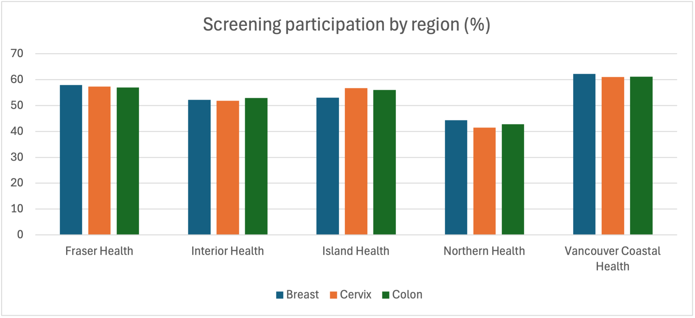
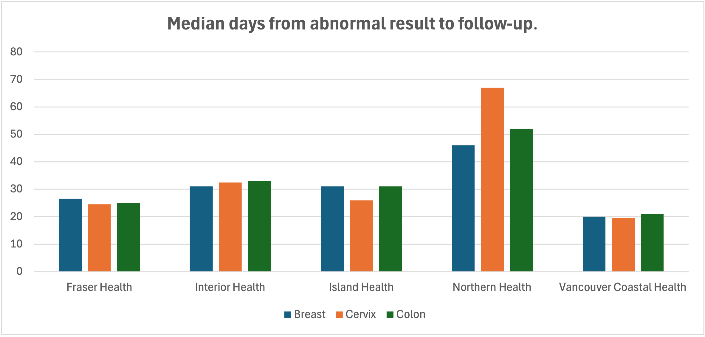

# Cancer Screening KPI Pipeline

A learning project: a SQL Server reporting pipeline for a cancer screening program, built on **synthetic data** for 20,000 patients across BC's five regional health authorities. It loads raw data, checks and cleans it, and calculates the KPIs a screening program reports on: participation rates and wait times from an abnormal result to diagnostic follow-up.

> All data is synthetic, generated with a fixed random seed. No real patient information is used, and **the results below say nothing about real BC screening**.

**Tools:** SQL Server 2022 (T-SQL) in Docker · Python (pandas, NumPy, pymssql) · Excel

## Validating the pipeline

The data generator builds in known patterns on purpose: lower screening rates and longer follow-up waits in rural regions (Northern and Interior). The test was whether the SQL pipeline, working only from the raw records, would recover those patterns correctly. It did:

| | Vancouver Coastal | Northern |
|---|---|---|
| Screening participation (breast) | 62.2% | 44.3% |
| Median days to follow-up (cervix) | 19.5 | 67 |
| Abnormal results followed up within target (cervix) | 92% | 35% |

- The participation KPI recovered the lower screening rate built in for Northern Health (about 43%) in all three programs.
- The follow-up KPI recovered the longer wait range built in for Northern (15–90 days, median ≈ 52), against 5–35 days for Vancouver Coastal.
- The dashboard also shows a pattern that wasn't programmed directly: breast screening misses its follow-up target most often, because its 30-day target is stricter than cervix and colon (60 days).

Small groups (e.g. Northern breast follow-ups, n = 6; patients with an unknown region, n ≈ 10 per program) are reported but are too small to interpret.




## How it works

```
CSV files ──► stg (raw, no rules) ──► data quality checks ──► dbo (clean, keys + constraints) ──► rpt (KPI views) ──► Excel
```

| Step | File | What it does |
|---|---|---|
| 1 | `data/generate_data.py` | Builds patients, exams and follow-ups using real program eligibility rules (age, sex), with regional differences in screening and wait times. Injects known data problems on purpose. |
| 2 | `sql/01_staging.sql`, `load_staging.py` | Creates staging tables and loads the CSVs. The load is safe to rerun (truncates first). |
| 3 | `sql/02_data_quality.sql` | Five checks: completeness, validity, uniqueness, consistency, timeliness. |
| 4 | `sql/03_clean.sql` | Builds the clean model with primary keys, foreign keys and CHECK constraints. Removes duplicates with `ROW_NUMBER()`, drops impossible dates, and flags bad follow-up dates for review. |
| 5 | `sql/04_kpis.sql` | KPI views: participation rate by program and region, median follow-up wait (`PERCENTILE_CONT`), % followed up within target, and % lost to follow-up. |
| – | `sql/test.sql` | Queries that pivot the KPI views into chart-ready tables for Excel. |
| 6 | `dashboard/` | Excel dashboard and charts built from the KPI views. |

## Data quality results

Every injected problem was caught, and each count was explained.

| Check | Type | Rows found | Action |
|---|---|---|---|
| Patient missing a health authority | Completeness | 30 | Kept; reported as "Unknown" |
| Exam dated in the future | Validity | 8 | Removed |
| Duplicate exam (same patient, program, date) | Uniqueness | 20 | Removed; kept the first record |
| Follow-up dated before its exam | Consistency | 11 | Date cleared and flagged for review |
| Abnormal result with no follow-up | Timeliness | 66 | Kept; counted in the "lost to follow-up" KPI |

Two counts were higher than the number of problems injected, and tracing why was the most useful part of the project:
- **11 follow-ups before exam (10 injected):** one future-dated exam was also abnormal, so its existing follow-up now looked earlier than the exam. Removing the bad exam resolved it (10 flagged after cleaning).
- **66 lost to follow-up (62 real):** 4 duplicate exam copies were abnormal and had no follow-up linked to their new IDs. **Duplicates were inflating a clinical KPI**, which is why the pipeline de-duplicates before reporting.

## Run it yourself

```bash
# 1. Start SQL Server in Docker
docker run -d --platform linux/amd64 --name screening-sql -e ACCEPT_EULA=Y \
  -e 'MSSQL_SA_PASSWORD=Screening#Dev2026' -p 1433:1433 mcr.microsoft.com/mssql/server:2022-latest

# 2. Python setup and data
python3 -m venv .venv && source .venv/bin/activate && pip install -r requirements.txt
python data/generate_data.py

# 3. Run sql/01_staging.sql, then load, then run 02 → 04 in order
python load_staging.py
```

(The password is for a local development container only.)

## Next steps
- Add KPIs for monthly screening volume (rolling average) and cancer detection rate per 1,000 screens
- Rebuild the dashboard in Power BI with slicers by program and region
- Add a data dictionary for every table and column
- Log each data quality run to an audit table to track quality over time
